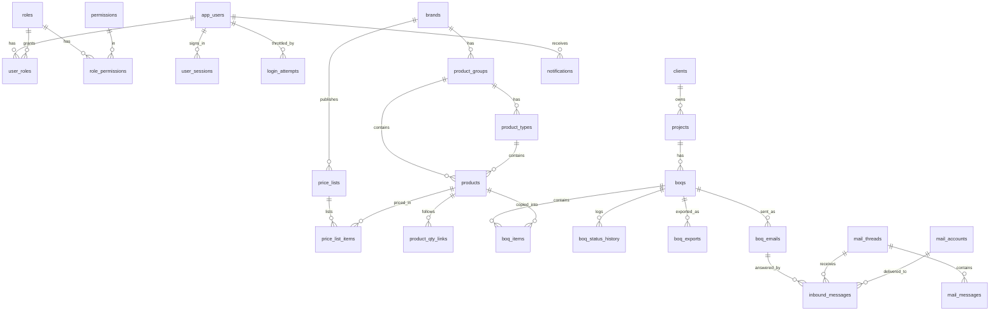

# HVAC BOQ Builder: database

PostgreSQL 17 (tested on 17.10). The app needs 15 or newer for the features it uses, but 17 is what it runs on.

## Install

From the project root:

```bash
npm run db:setup            # backs up, creates the database if needed, runs every db/NN_*.sql once
npm run db:status           # shows what is applied and what is pending
```

Applied files are recorded in `schema_migrations` with a sha-256 checksum. Two behaviours to know:

- **A changed file is an error.** If an applied `NN_*.sql` differs from its checksum, `db:setup` prints the file and
  exits non-zero. Add a new numbered file instead of editing one; `--force` overrides deliberately.
- **It dumps first.** Before migrating an existing database it writes a `pg_dump` (custom format) to `BACKUP_DIR`
  (default `../technocool-backups`). A dump holds password hashes and encrypted tokens, so it must stay out of the
  repository. `--no-backup` skips it for a throwaway database.

Manual alternative (rarely needed):

```bash
createdb hvac_boq
for f in $(ls db/NN_*.sql | sort); do psql -d hvac_boq -v ON_ERROR_STOP=1 -f "$f"; done
psql -d hvac_boq -c "INSERT INTO schema_migrations (filename, checksum) VALUES ('manual', 'manual')"
```

All seeds can be re-run safely. After loading, set the company details in the app (Admin → Settings) or in
`company_settings`, and create the first administrator:

```bash
npm run create-admin -- --email you@company.com --name "Your Name"
```

## Restoring `db file/hvac_boq.sql`

That file is a full plain-SQL dump of a working database: schema, all 15 migrations, the price lists, real users,
clients, BOQs, mail and audit history. It is committed so a collaborator can start with real data instead of an
empty schema.

```bash
# 1. the dump has no CREATE DATABASE, so make the database first
createdb -U postgres hvac_boq

# 2. restore (use psql 17 or newer: the dump starts with a \restrict line that older psql rejects)
psql -U postgres -d hvac_boq -v ON_ERROR_STOP=1 -f "db file/hvac_boq.sql"
```

Then point `DATABASE_URL` at it in `.env.local` and check:

```bash
npm run db:setup -- --status    # every migration should already be "applied"
```

Every migration checksum in the dump matches the files in this folder, so `db:setup` is a no-op rather than a
"file has CHANGED" error.

Two things that will bite a restore on a different machine:

- **`OWNER TO postgres`** appears 49 times. If your superuser is not literally `postgres`, either restore as the
  `postgres` role or drop those lines first:
  `sed '/^OWNER TO/d' "db file/hvac_boq.sql" | psql -U <you> -d hvac_boq`
- **`\restrict` / `\unrestrict`** come from `pg_dump` 17.6+. On psql 15/16, remove those two lines the same way,
  or install the matching client.

What a collaborator gets and does not get:

- **Users exist but their passwords are argon2 hashes.** Nobody can sign in as them. Create your own admin:
  `npm run create-admin -- --email you@company.com --name "Your Name"`.
- **Google is not connected.** `mail_config` / `mail_accounts` hold tokens encrypted with the owner's
  `GMAIL_TOKEN_KEY`, which is not in the repository. Admin → Gmail will show "disconnected": connect your own
  mailbox, or leave it disconnected while working on everything except mail.
- **`storage/` is not committed** (it is gitignored). BOQ exports can simply be generated again; attachments on
  older conversations will be listed but not downloadable.
- **This dump contains real client data.** It belongs in a private repository and should not be shared outside the
  team or attached to tickets.

## Migrations

| File | What it adds |
|---|---|
| `01_schema.sql` | Tables, triggers, views, functions: identity, settings, catalog, clients, projects, BOQ, audit |
| `02_seed_reference.sql` | 4 roles, 30 permissions, brands, company defaults |
| `03_seed_price_lists.sql` | LG, Daikin, DB and local price lists (470 products) |
| `04_mail_and_ownership.sql` | BOQ owners, locking of sent BOQs, mail/reply/notification tables |
| `05_send_settings.sql` | Send templates, daily recipient limit, `boq_emails` |
| `06_recipient_arrays.sql` | `to_addrs` / `cc_addrs` as arrays, not text |
| `07_reply_lookups.sql` | Reply routing lookups (thread, `Message-ID`, plus-tag, subject code) |
| `08_reply_constraint.sql` | One reply per Gmail message |
| `09_manual_attachments.sql` | `boq_exports.source = 'manual'`, original name, hash |
| `10_mail_config.sql` | `mail_config`: OAuth client ID/secret/mailbox, encrypted, editable from Admin → Gmail |
| `11_client_permissions.sql` | Split `crm.clients.create` from `crm.clients.manage` |
| `12_client_manage_manager.sql` | Managers may edit/delete clients; estimators may only add |
| `13_client_mail.sql` | Client e-mail on the thread tables, so a conversation can start without a BOQ |
| `14_login_attempts.sql` | `login_attempts`: per-e-mail, per-IP and site-wide throttling |
| `15_worker_heartbeat.sql` | `worker_status`: one row the Gmail page and `/api/health` read |

## What is inside

| Module | Tables | Purpose |
|---|---|---|
| Identity and access | `app_users`, `roles`, `permissions`, `role_permissions`, `user_roles`, `user_sessions`, `auth_tokens`, `login_attempts` | Sign-in, sessions, password reset and invite links, role-based permissions, brute-force throttling |
| Settings | `company_settings`, `exchange_rates`, `doc_counters`, `mail_config`, `worker_status` | Company details, defaults for new BOQs, USD rate history, yearly numbers (P-2026-0001, BOQ-2026-0001), Gmail client and mailbox, worker heartbeat |
| Catalog | `brands`, `product_groups`, `product_types`, `products`, `product_qty_links`, `price_lists`, `price_list_items` | Product master and versioned price lists, one active per brand |
| Clients and projects | `clients`, `projects` | Who the offer is for and where. Clients are soft-deleted (`deleted_at`) because `projects.client_id` restricts deletion |
| BOQ | `boqs`, `boq_items`, `boq_status_history`, `boq_exports` | BOQ with revisions; each line is a copy of the product so later price changes never alter a sent offer |
| Mail out | `boq_emails`, `mail_messages`, `mail_accounts` | Queued/sent mail for both BOQ sends and general messages; the connected Google account |
| Mail in | `inbound_messages`, `mail_threads` | Client replies, where they were routed, and the conversation they belong to |
| Notifications | `notifications` | In-app alerts (reply received, send failed, Gmail disconnected, BOQ assigned) |
| Audit | `audit_log` | Every insert, update and delete on money and access tables, with the acting user |

Seeded data: 4 roles, 30 permissions, 3 brands, 4 price lists, 470 products (LG 119, Daikin 171, DB 120, local 60).

The 30 permissions are grouped as `iam.*` (users, roles), `settings.*`, `catalog.*` (view, cost, edit, publish),
`crm.*` (clients view/create/manage, projects), `boq.*` (view, view_all, create, edit_own, edit_any, delete, approve,
export, send, discount, costing), `mail.*` (send, view_all, unmatched.manage), `integrations.gmail.manage` and
`audit.view`. Admin 28, manager 23, estimator 13, viewer 4.



## How the app maps to the tables

| In the app | In the database |
|---|---|
| Brand LG / Daikin / DB | `boqs.selected_brand_id`. Line A rows of the other brands stay in `boq_items` for comparison and are left out of the offer (`counts_in_offer = false`). |
| Brand cards (imported totals only) | `v_boq_brand_totals`: line A only, never local items |
| Line A / B / C | `boq_items.line` |
| Profit % and discount % on an item | `boq_items.profit_pct`, `discount_pct`; NULL means the BOQ default |
| Insulation "auto from pipe" | `boq_items.qty_follows_links = true` + `product_qty_links` |
| Edit item in a BOQ | Update the `boq_items` row and set `is_edited = true` |
| Edit or delete a product in the price list | `products` / `price_list_items` (soft delete with `products.deleted_at`), needs `catalog.edit` |
| Totals strip, offer summary | `v_boq_item_amounts`, `v_boq_totals` (same rounding as the app; checked to the paisa) |
| Export BDT / USD | `boqs.offer_currency`; each export is logged in `boq_exports` |
| "Send BOQ" | One transaction: lock the BOQ, `boq_exports` rows, a `boq_emails` row with status `queued` — or nothing at all |
| "Send message" (Inbox) | `mail_messages` row; the worker turns it into a Gmail message |
| A conversation | `mail_threads`; both `boq_emails` and `mail_messages` point at it. `kind = 'boq' \| 'general'` |
| Reply address in the thread | `boq_emails.tag` → `mailbox+<tag>@gmail.com`, so replies route back without reading the mailbox |
| Replies the admin must sort | `inbound_messages` with `boq_id IS NULL`, shown on Admin → Unmatched replies |
| Who sees a conversation | `boq_emails.sent_by` / `mail_messages.sent_by` plus `mail.view_all` for admin and manager |
| Worker alive? | `worker_status.last_seen_at`, refreshed every 30 s |
| Undo / Reset | Done in the app before saving; the audit log keeps every saved change |

## Rules for the API

1. Start each request's transaction with `SET LOCAL app.user_id = '<user uuid>';` so the audit log and status history know who acted.
2. Check permissions on the server with `user_has_permission(user_id, 'boq.export')`. Never rely on hidden buttons.
3. Hide `cost`, `profit` and the costing export from users without `boq.costing.view` / `catalog.cost.view`.
4. After saving BOQ lines call `SELECT refresh_boq_totals(:boq_id);` so list pages show current totals.
5. To send a changed offer, call `SELECT create_boq_revision(:boq_id);` instead of editing a sent BOQ.
6. Store only hashes of refresh and reset tokens (SHA-256) and of passwords (argon2id).
7. Never store a Google token in plain text: `mail_config` and `mail_accounts` hold AES-256-GCM blobs keyed by
   `GMAIL_TOKEN_KEY`. Rotating that key invalidates stored tokens — the app then asks the admin to reconnect.
8. The test suite needs `TEST_DATABASE_URL` pointing at a separate `*_test` database; it deletes rows.
